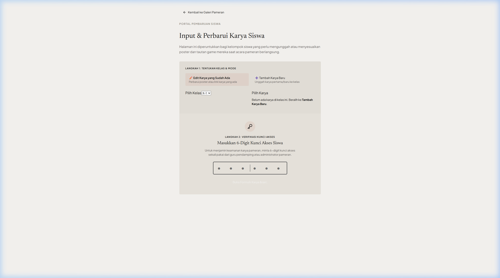
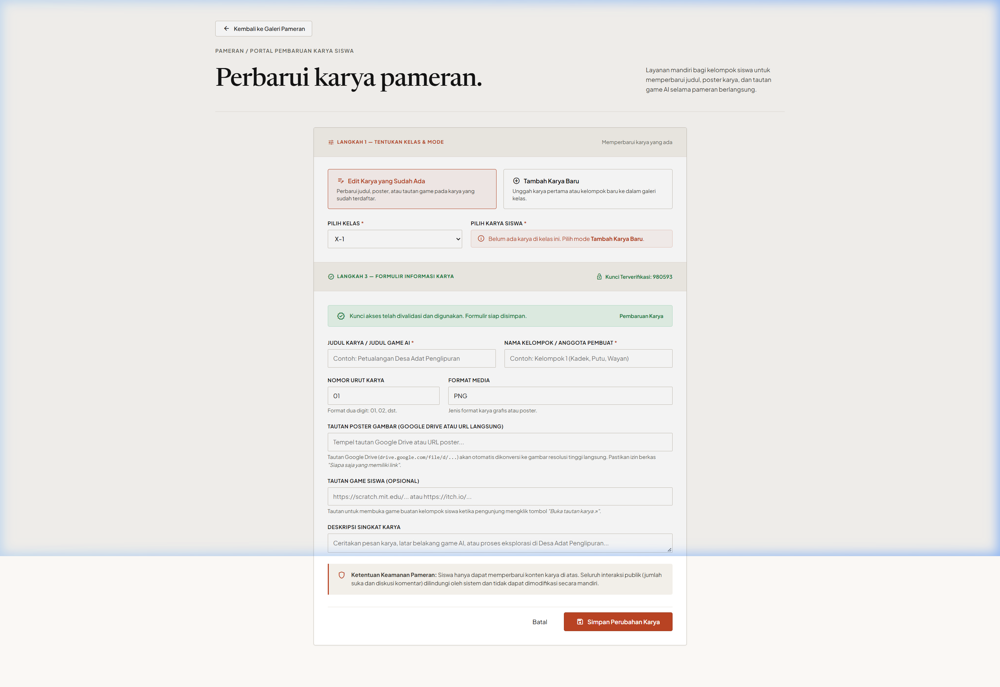
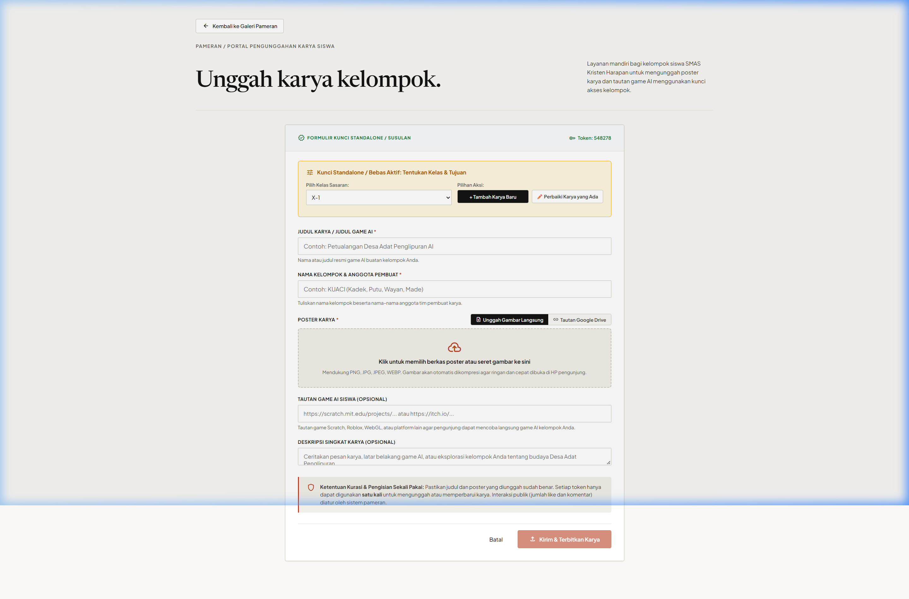
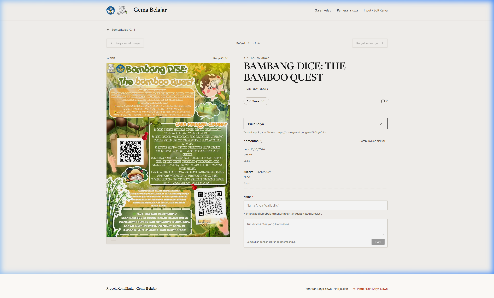

# Panduan Lengkap Siswa: Pengunggahan & Pembaruan Karya
## Pameran Kokulikuler AI Game — "Gema Belajar"
### SMAS Kristen Harapan Denpasar (Bali)

Selamat datang di sistem kurasi mandiri karya pameran **Gema Belajar**! Dokumen ini memandu setiap kelompok siswa untuk mengunggah karya game AI dan poster pameran secara mandiri, rapi, dan optimal.

---

## 📌 1. Persiapan Sebelum Mengisi

Sebelum membuka portal pengunggahan, pastikan perwakilan kelompok telah menyiapkan:

1. **Kunci Akses 6-Digit Kelompok**:  
   Dapatkan token unik 6 digit (contoh: `965769`) dari guru pendamping atau panitia pameran. Setiap kelompok memiliki **1 token khusus** dengan **1 kesempatan simpan**.
2. **Berkas Poster Karya**:  
   - Format: JPG, PNG, JPEG, atau WebP.
   - Sistem dilengkapi **kompresi otomatis modern** (mengubah gambar besar menjadi WebP ~150 KB beresolusi tajam tanpa mengurangi kualitas visual).
   - *Alternatif:* Anda juga dapat menggunakan link **Google Drive** poster (pastikan hak akses sudah disetel ke *"Siapa saja yang memiliki tautan dapat melihat"*).
3. **Tautan Game AI Siswa**:  
   Tautan game yang dapat dimainkan langsung (misalnya di web, itch.io, Google Drive build, dsb.).
4. **Nama Kelompok & Anggota**:  
   Nama kelompok (sesuai daftar kurasi) beserta nama lengkap anggota tim.

---

## 🚀 2. Cara Mengunggah Karya Baru (Langkah demi Langkah)

### Langkah 1: Buka Portal Mandiri Siswa
1. Buka situs pameran Gema Belajar di browser ponsel atau laptop Anda.
2. Di pojok kanan atas bilah navigasi, klik menu **"Input / Edit Karya"** (atau buka langsung alamat: `https://[alamat-web]/edit`).

---

### Langkah 2: Masukkan Kunci Akses 6-Digit
1. Ketikkan 6 digit token kelompok Anda pada kotak PIN yang tersedia.
2. Klik tombol **"Masuk & Buka Formulir"**.
3. Sistem akan memverifikasi token dan **otomatis menghubungkan Anda ke kelas dan kelompok Anda**.

> **Catatan Penting:**  
> Banner biru di bagian atas formulir akan mengonfirmasi identitas kelompok dan kelas Anda. Nomor urut karya (*Karya 01, Karya 02, dst.*) akan diatur secara otomatis dan berurutan oleh sistem galeri.

---

### Langkah 3: Mengisi Formulir Karya Kelompok

Isi formulir dengan data proyek game AI Anda:

1. **Judul Karya / Game AI (Wajib):**  
   Tuliskan judul game kelompok Anda secara jelas dan menarik (contoh: *Bambang-Dice: The Bamboo Quest*).
2. **Nama Kelompok & Anggota (Wajib):**  
   Sebutkan nama kelompok dan nama seluruh anggota tim pembuat (contoh: *KUACI — Made, Putu, Kadek*).
3. **Unggah Poster Karya (Wajib):**  
   Pilih salah satu metode berikut:
   - **Opsi A: Unggah Berkas Langsung (Direkomendasikan)**  
     Tarik (*drag & drop*) berkas gambar poster Anda ke area unggah atau klik untuk memilih berkas dari HP/Laptop. Sistem otomatis mengompresi gambar menjadi format WebP yang sangat ringan (~100-200 KB).  
     > **Indikator Sukses yang Jelas:** Begitu gambar selesai diproses, kotak abu-abu besar otomatis **tertutup/disembunyikan** dan berganti menjadi **Kartu Konfirmasi Hijau** yang menampilkan thumbnail poster, lencana centang verifikasi, dan rincian ukuran file. Anda tidak perlu bingung lagi apakah file sudah masuk atau belum. Bila ingin mengganti, cukup klik tombol *"Ganti Berkas Gambar"*.
   - **Opsi B: Tautan Google Drive**  
     Pilih tab *Tautan Google Drive*, lalu tempelkan link berbagi poster Google Drive Anda. Sistem akan langsung mengonversinya menjadi gambar pameran yang tampil di galeri.
4. **Tautan Game AI Siswa:**  
   Tempelkan URL game Anda agar pengunjung pameran dapat menekan tombol **"Buka Karya"** untuk mencoba game Anda.
5. **Deskripsi Karya:**  
   Ceritakan ide cerita game, latar belakang budaya/Penglipuran, atau cara memainkan game kelompok Anda.

---

### Langkah 4: Simpan & Publikasikan Karya
1. Periksa kembali seluruh data yang telah Anda masukkan.
2. Klik tombol **"Simpan & Publikasikan Karya"** di bagian bawah formulir.
3. Selamat! Karya Anda telah resmi terpasang di galeri kelas. Token kelompok Anda akan berstatus selesai terpakai.

---

## ✏️ 3. Cara Mengedit / Memperbaiki Karya yang Sudah Diinput

Jika karya kelompok Anda sudah pernah disimpan tetapi ada perbaikan mendesak (misalnya: revisi poster, update link game baru, atau typo judul):

1. **Minta Kunci Standalone / Bebas ke Panitia/Guru**:  
   Jelaskan bagian apa yang ingin diperbaiki agar panitia memberikan kunci darurat susulan.
2. **Buka Portal `/edit`** dan masukkan kunci standalone tersebut.
3. Sistem akan mengenali kunci tersebut dan menampilkan panel pilihan:
   - **Pilih Kelas Sasaran**: Pilih kelas Anda (contoh: *X-4*).
   - **Pilihan Aksi**: Klik tombol **"✏️ Perbaiki Karya yang Ada"**.
   - **Pilih Karya**: Pilih judul karya kelompok Anda dari daftar dropdown.

4. Seluruh data karya lama akan otomatis dimuat ke formulir. Ubah bagian yang perlu diperbaiki, lalu klik **"Simpan & Publikasikan Karya"**.
5. *Semua jumlah suka (likes) dan komentar yang sudah diberikan oleh pengunjung galeri akan tetap aman terjaga.*

---

## 🎨 4. Tampilan Karya di Galeri Pameran

Setelah disimpan, karya kelompok Anda akan langsung dapat dinikmati oleh seluruh guru, siswa, dan pengunjung:

* **Tombol "Buka Karya"**: Terletak jelas di atas kolom komentar agar pengunjung langsung mencoba game Anda.
* **Diskusi & Apresiasi**: Pengunjung dan siswa lain dapat memberikan likes serta komentar (nama wajib diisi dengan format: **`nama-kelas-absen`**, contoh: `Wayan-X1-12`).

---

## ❓ 5. Pertanyaan Umum & Kendala Teknis (FAQ)

### Q: Kunci muncul tulisan *"Kunci akses sudah digunakan"*?
> **Jawab:** Setiap kunci kelompok hanya dapat digunakan 1 kali simpan. Jika Anda sudah pernah menekan tombol simpan atau salah satu anggota tim sudah menyimpannya, kunci tidak dapat digunakan ulang. Hubungi panitia/guru untuk mendapatkan kunci revisi.

### Q: Poster dari Google Drive tidak muncul atau pecah?
> **Jawab:** Pastikan pengaturan link berbagi di Google Drive telah disetel ke **"Anyone with the link can view" (Siapa saja yang memiliki tautan dapat melihat)**. Atau lebih mudahnya, gunakan tombol **"Unggah Berkas Langsung"** agar gambar langsung tersimpan di galeri.

### Q: Apakah bisa mengunggah dari HP?
> **Jawab:** Ya, seluruh halaman web Gema Belajar didesain responsif dan ringan, sehingga lancar digunakan di perangkat ponsel Android maupun iPhone.
