# Panduan Lengkap Siswa: Pengunggahan & Pembaruan Karya
## Pameran Kokurikuler — "Gemar Belajar"
### SMAS Kristen Harapan Denpasar (Bali)

Selamat datang di sistem kurasi mandiri karya pameran **Gemar Belajar**! Dokumen panduan ini disusun khusus agar setiap kelompok siswa dapat mengunggah poster dan tautan karya pameran secara mandiri, rapi, dan percaya diri dengan panduan visual langkah demi langkah.

---

## 📌 1. Persiapan Sebelum Mengisi Formulir

Sebelum membuka portal pengunggahan, pastikan perwakilan kelompok telah menyiapkan 4 hal berikut:

1. **Kunci Akses 6-Digit Kelompok**:  
   Dapatkan token unik 6 digit (contoh: `965769`) dari guru pendamping atau panitia. Setiap kelompok memiliki **1 token khusus** dengan **1 kesempatan simpan**.
2. **Berkas Poster Karya**:  
   - Format gambar: JPG, PNG, JPEG, atau WebP.
   - Sistem dilengkapi **kompresi otomatis modern** yang langsung mengubah gambar menjadi format WebP ringan (~100–200 KB) dengan resolusi tajam agar cepat dimuat di HP pengunjung.
   - *Alternatif:* Tersedia opsi **Tautan Google Drive** jika berkas poster tersimpan di Drive.
3. **Tautan Karya Siswa (Opsional)**:  
   Tautan karya buatan kelompok Anda (misalnya tautan Web, Scratch, Google Drive, dsb.) agar pengunjung dapat langsung membuka dan mencobanya.
4. **Nama Kelompok & Anggota**:  
   Nama kelompok (sesuai daftar kurasi) beserta nama seluruh anggota tim pembuat.

---

## 🚀 2. Panduan Langkah demi Langkah Mengunggah Karya Baru

### Langkah 1: Buka Portal Mandiri Siswa
1. Buka situs web pameran Gemar Belajar di browser HP atau laptop Anda.
2. Di pojok kanan atas bilah navigasi, klik menu **"Input / Edit Karya"** (atau buka alamat langsung: `https://[alamat-web]/edit` atau `#edit`).

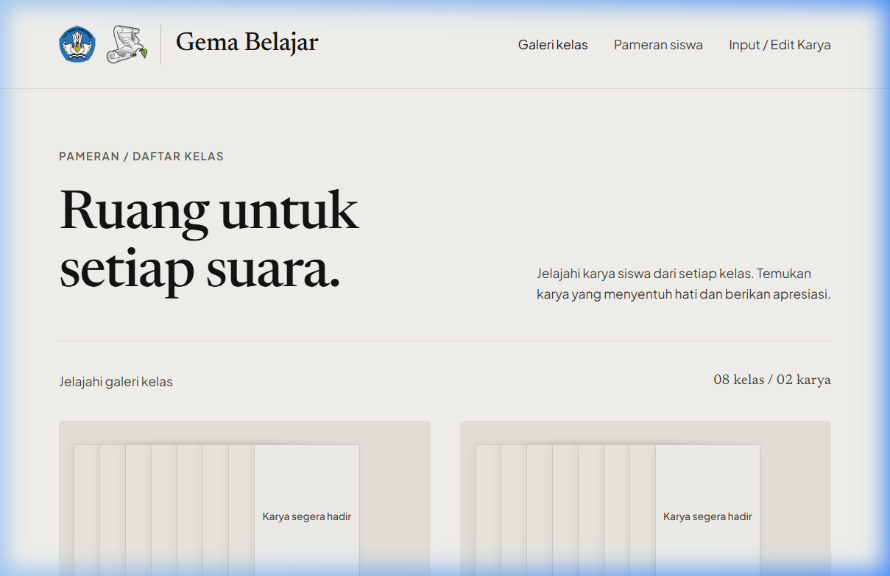

---

### Langkah 2: Masukkan Kunci Akses 6-Digit Kelompok
1. Masukkan 6 digit angka token kelompok Anda pada kotak PIN yang disediakan.
2. Klik tombol terracotta bertuliskan **"Masuk & Buka Formulir →"**.

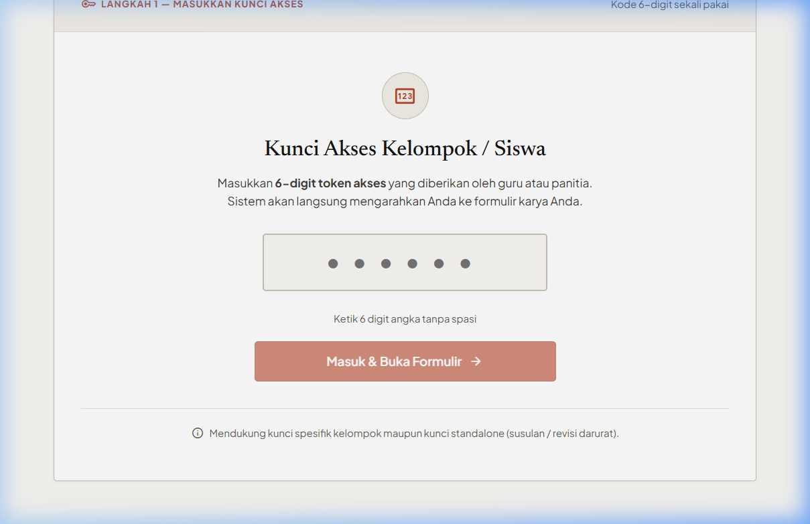

---

### Langkah 3: Verifikasi Identitas Kelompok & Kelas Terbuka Otomatis
1. Sistem akan memverifikasi token dan **otomatis mengenali kelas dan nama kelompok Anda**.
2. Perhatikan banner biru di bagian atas formulir:  
   - Menampilkan konfirmasi identitas: contoh `Kelas: X-1 • KUACI`.
   - Nomor urut karya (*Karya 01, Karya 02, dst.*) diatur secara otomatis dan rapi oleh sistem galeri.

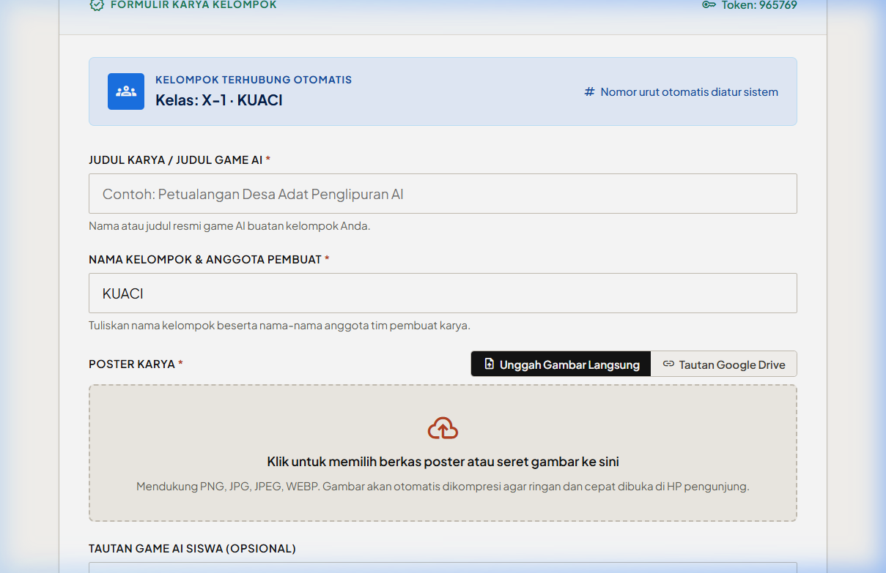

---

### Langkah 4: Mengisi Judul Karya dan Anggota Tim
1. **Judul Karya (Wajib):**  
   Tuliskan judul karya kelompok Anda secara jelas dan menarik (contoh: *Harmoni Alam Desa Adat Penglipuran*).
2. **Nama Kelompok & Anggota Pembuat (Wajib):**  
   Tuliskan nama kelompok beserta nama-nama anggota tim pembuat karya (contoh: *KUACI (Kadek, Putu, Wayan, Made)*).

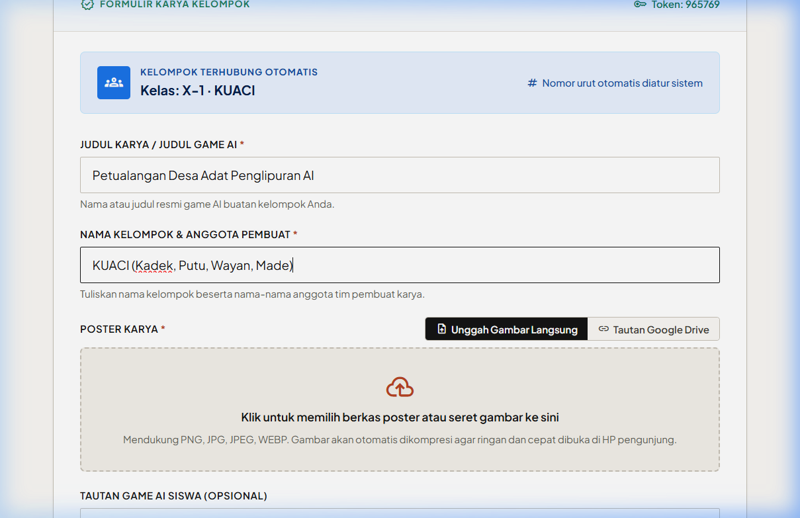

---

### Langkah 5: Mengunggah Poster Karya

Pilih salah satu dari 2 metode yang tersedia:

#### Opsi A: Unggah Berkas Gambar Langsung (Sangat Direkomendasikan)
1. Klik area kotak putus-putus abu-abu bertuliskan *"Klik untuk memilih berkas poster atau seret gambar ke sini"*, atau tarik (*drag & drop*) berkas gambar poster dari galeri HP/laptop Anda.
2. Tunggu 1–2 detik saat sistem otomatis mengompresi gambar ke format WebP ringan.

> **💡 Kepastian Visual (Anti-Ragu):**  
> Begitu berkas selesai diproses, **kotak abu-abu besar otomatis hilang/disembunyikan** dan seketika berganti menjadi **Kartu Konfirmasi Hijau** yang membuktikan bahwa berkas Anda sudah 100% terpasang dengan aman!

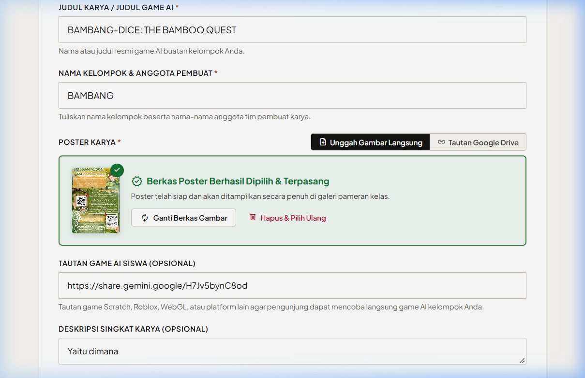

Kartu konfirmasi hijau menampilkan:
* **Thumbnail Pratinjau**: Pratinjau poster Anda dengan lencana centang hijau.
* **Status Terverifikasi**: Label tebal bertuliskan `Berkas Poster Berhasil Dipilih & Terpasang`.
* **Tombol "Ganti Berkas Gambar"**: Jika ingin memilih ulang berkas lain.
* **Tombol "Hapus & Pilih Ulang"**: Menghapus poster dan memunculkan kembali kotak seret awal.

---

#### Opsi B: Menggunakan Tautan Google Drive (Alternatif)
Jika poster Anda berada di Google Drive:
1. Klik tab **"Tautan Google Drive"**.
2. Tempelkan link berbagi Google Drive Anda ke dalam kotak input.
3. Sistem secara otomatis mendeteksi dan menampilkan banner hijau **Pratinjau Poster Terdeteksi**.

> **Penting untuk Google Drive:** Pastikan izin berbagi pada file Google Drive Anda telah disetel ke *"Siapa saja yang memiliki tautan dapat melihat"* (Anyone with the link can view).

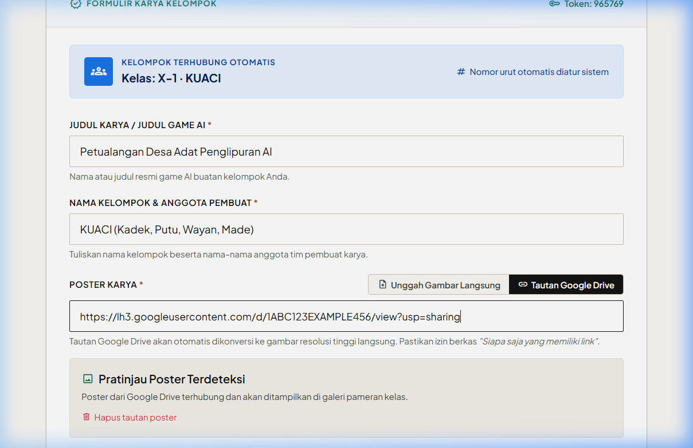

---

### Langkah 6: Masukkan Tautan Karya & Simpan Karya
1. **Tautan Karya Siswa (Opsional):**  
   Tempelkan tautan karya kelompok Anda agar pengunjung pameran dapat membuka atau mencobanya.
2. **Deskripsi Singkat Karya (Opsional):**  
   Tuliskan latar belakang karya, refleksi nilai budaya/Penglipuran, atau konsep eksplorasi kelompok Anda.
3. Periksa kembali seluruh isian formulir.
4. Klik tombol merah-bata **"Kirim & Terbitkan Karya"** di bagian paling bawah formulir.

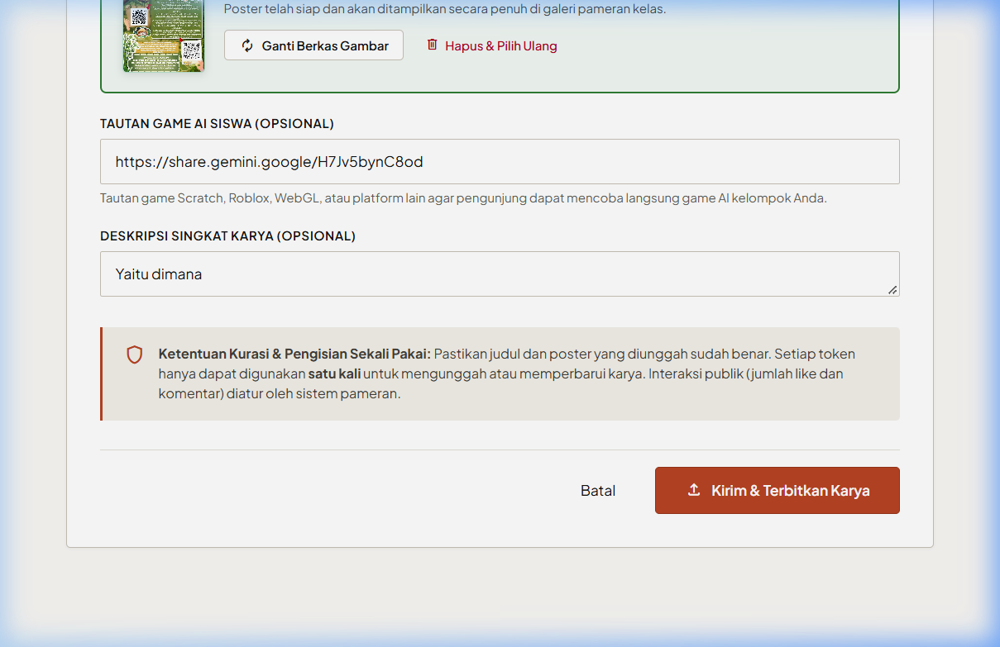

---

### Langkah 7: Layar Konfirmasi Sukses Penerbitan
Setelah tombol simpan ditekan, sistem menampilkan layar sukses:
1. Muncul pesan **"Karya Berhasil Diterbitkan"** dengan centang hijau besar.
2. Kunci akses kelompok Anda ditandai selesai (1 kali penggunaan).
3. Anda dapat menekan tombol **"Lihat Karya di Galeri Kelas"** untuk langsung melihat hasil tampilannya di pameran umum!

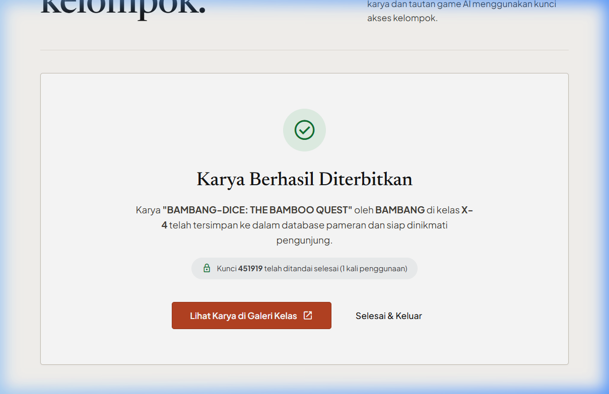

---

## ✏️ 3. Cara Mengedit / Memperbaiki Karya yang Sudah Diinput

Jika karya kelompok Anda sudah pernah disimpan tetapi ada perbaikan mendesak (misalnya: revisi poster baru, perbaikan link game, atau typo pada judul/nama):

1. **Minta Kunci Akses Standalone / Susulan** ke guru pendamping atau panitia pameran.
2. Buka halaman `/edit` dan masukkan kunci standalone tersebut.
3. Pada panel kuning yang muncul:
   - **Pilih Kelas Sasaran**: Pilih kelas kelompok Anda (misal: `X-4`).
   - **Pilihan Aksi**: Klik tombol hitam bertuliskan **"Perbaiki Karya yang Ada"**.
   - **Pilih Karya yang Ingin Diperbaiki**: Pilih judul karya kelompok Anda dari daftar dropdown.
4. Seluruh data karya lama akan otomatis termuat ke formulir. Ubah bagian yang perlu diperbaiki, lalu klik **"Kirim & Terbitkan Karya"**.

> *Catatan:* Semua jumlah suka (*likes*) dan komentar yang sudah diberikan oleh pengunjung galeri akan tetap aman terjaga dan tidak akan hilang saat Anda melakukan revisi.

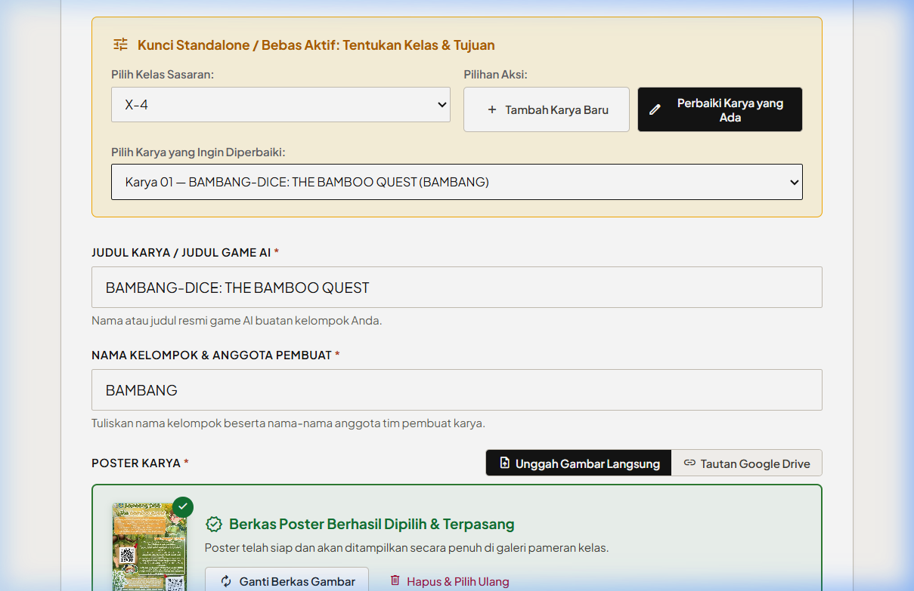

---

## 🎨 4. Tampilan Karya di Galeri Pameran & Interaksi Pengunjung

Setelah karya Anda terbit, seluruh pengunjung pameran dapat menikmati karya Anda:

### Tampilan Karya di Galeri Pameran
Karya Anda akan tampil dengan poster beresolusi tinggi, lencana kelas, judul, nama pembuat, serta tombol apresiasi *Suka*.

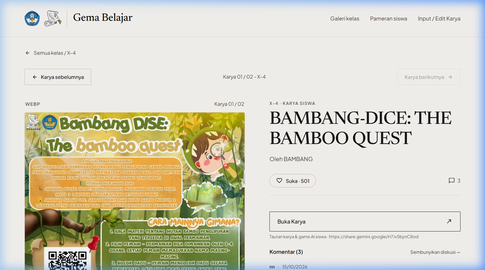

---

### Tombol "Buka Karya" & Kolom Komentar Apresiasi
Di halaman detail karya:
1. **Tombol "Buka Karya"**: Terletak jelas di atas kolom komentar agar pengunjung langsung membuka karya buatan kelompok Anda.
2. **Kolom Komentar Terstruktur**: Pengunjung dan teman sekelas dapat memberikan apresiasi dengan mencantumkan nama berformat resmi:  
   **`nama-kelas-absen`** (Contoh: `Wayan-X1-12`).

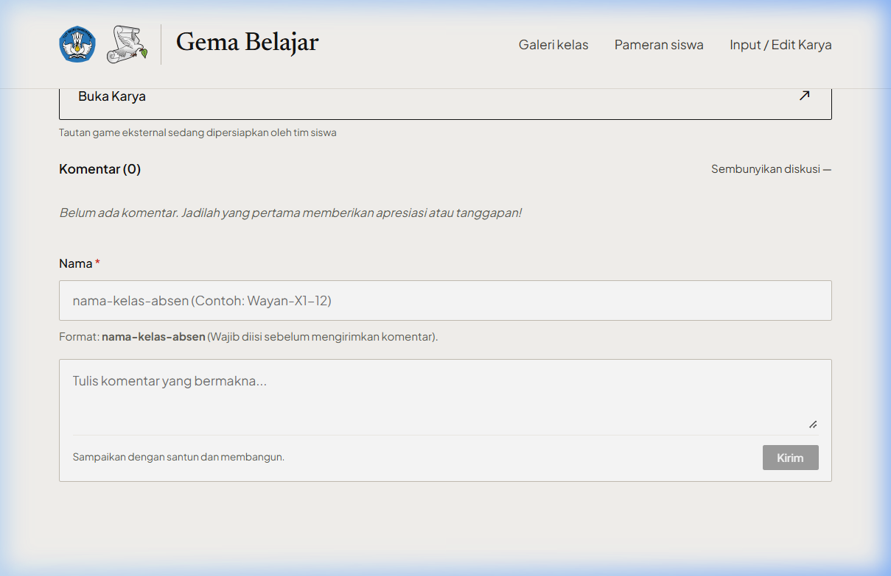

---

## ❓ 5. Pertanyaan Umum & Kendala Teknis (FAQ)

### Q: Muncul pesan *"Kunci akses sudah digunakan"* saat memasukkan token?
> **Jawab:** Setiap kunci kelompok hanya dapat digunakan untuk 1 kali penyimpanan resmi demi menjaga keamanan data kurasi. Jika kelompok Anda perlu melakukan revisi poster atau judul, silakan lapor ke panitia/guru pendamping untuk diberikan kunci susulan/standalone.

### Q: Mengapa setelah mengunggah gambar, kotak seret file hilang?
> **Jawab:** Itu adalah fitur otomatis sistem! Kotak abu-abu sengaja ditutup dan digantikan oleh **Kartu Konfirmasi Hijau** agar Anda yakin 100% bahwa poster sudah berhasil terpasang. Jika ingin mengganti gambar, cukup klik tombol *"Ganti Berkas Gambar"* di kartu hijau tersebut.

### Q: Poster dari Google Drive tidak muncul atau pecah?
> **Jawab:** Pastikan pengaturan link berbagi di Google Drive telah disetel ke **"Anyone with the link can view" (Siapa saja yang memiliki tautan dapat melihat)**. Atau gunakan **"Unggah Gambar Langsung"** agar gambar langsung tersimpan di galeri.

### Q: Apakah bisa mengunggah dan membuka pameran dari HP?
> **Jawab:** Tentu saja bisa! Seluruh sistem Gemar Belajar didesain responsif dan sangat ringan untuk dibuka melalui Google Chrome atau Safari di perangkat Android maupun iPhone.
